# Week 5: Power BI & Business Intelligence

### Superstore Sales Dashboard | InternNova Internship

**Name:** Gajanan Raje  
**Course:** TYBCA, MGM's College of Computer Science & IT, Nanded  
**Tool:** Microsoft Power BI Desktop  
**Dataset:** Sample Superstore (9,994 rows)

---

## 1. Project Overview

This project turns raw retail sales data into a clean data model and an interactive Power BI dashboard. The data is imported and cleaned in Power Query, modeled as a star schema, analysed with DAX measures and presented in a dark-themed dashboard with KPI cards, charts and slicers. The goal is to show **what sells, who buys, where profit comes from and where money is lost.**

---

## 2. Final Dashboard

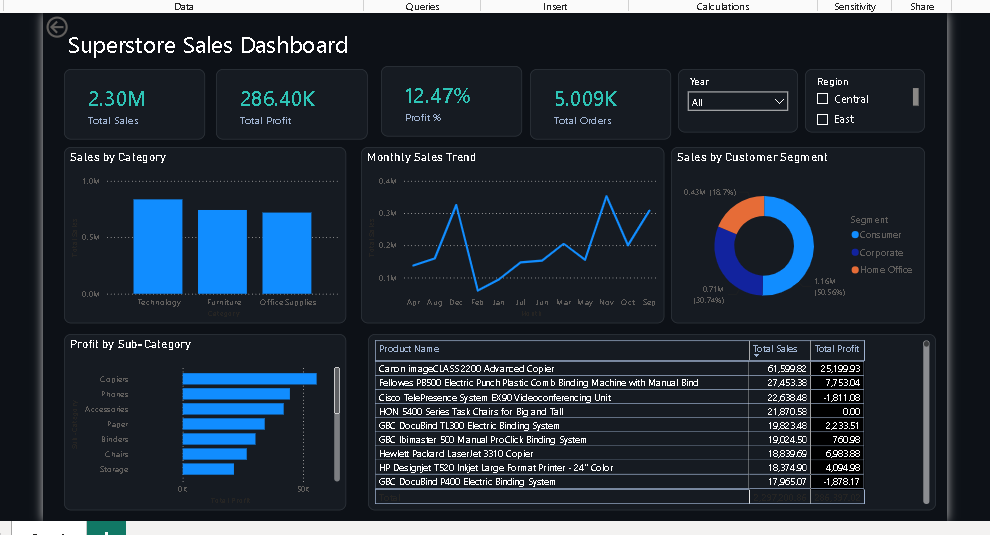

### Filtered view (Year = 2017, Region = West)


All cards and visuals update together when a slicer value is selected.

---

## 3. Skills and Components Used

| # | Skill / Component | Where used |
|---|---|---|
| 1 | Data Import (Get Data > Text/CSV) | Task 1 |
| 2 | Power Query (cleaning, data types, custom column) | Task 2 |
| 3 | Data Modeling (star schema, relationships) | Task 3 |
| 4 | DAX (measures, calculated column, calculated table) | Task 4 |
| 5 | KPI Cards | Task 6 |
| 6 | Column Chart | Task 5 |
| 7 | Line Chart | Task 5 |
| 8 | Donut Chart | Task 5 |
| 9 | Bar Chart | Task 5 |
| 10 | Table Visual | Task 5 |
| 11 | Slicers (Year, Region) | Task 6 |
| 12 | Dashboard formatting (dark theme, layout) | Task 6 |
| 13 | Insights and Recommendations | Task 7 |

---

## 4. Work Done (Skill by Skill, with Screenshots)

### 4.1 Data Import (Task 1)
Imported `Orders_fixed.csv`, `Customers.csv` and `Products.csv` using **Home > Get data > Text/CSV**, then opened them with **Transform Data**.

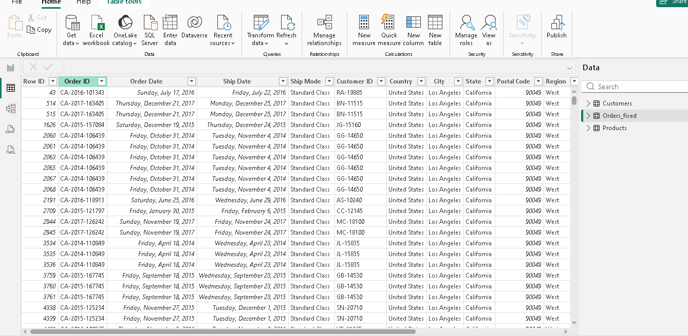
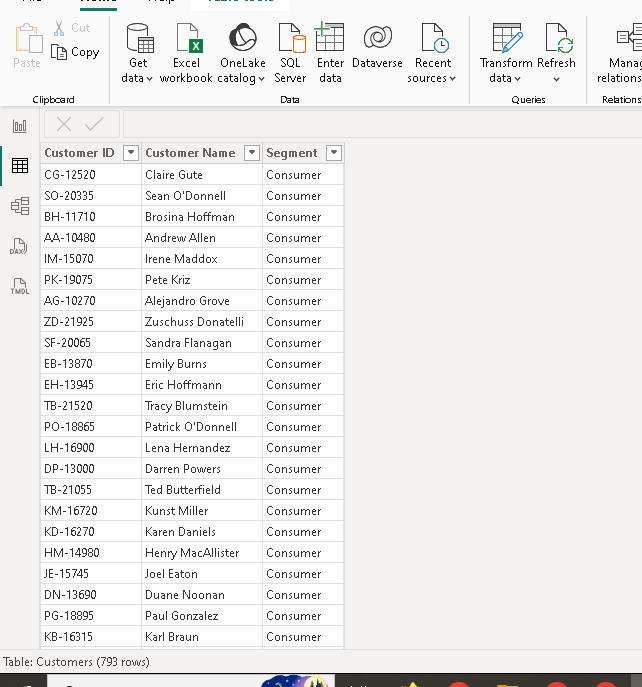
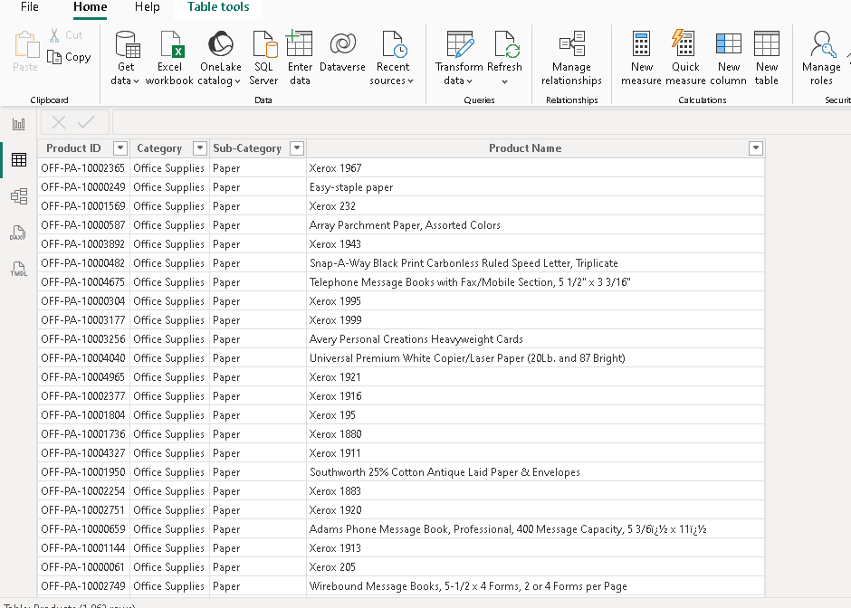

### 4.2 Data Cleaning in Power Query (Task 2)
- Used **Use First Row as Headers** on Customers and Products.
- Fixed data types (dates, decimals, whole numbers, text).
- Fixed the date locale problem: M/D/YYYY dates were read wrongly, so dates were loaded in ISO format (YYYY-MM-DD).
- Checked **Column quality / Column profile** for errors, empty values and duplicates.
- Removed duplicates and unnecessary columns.
- Added custom column `ShipDays = Duration.Days([Ship Date] - [Order Date])`.
- Clicked **Close & Apply**.

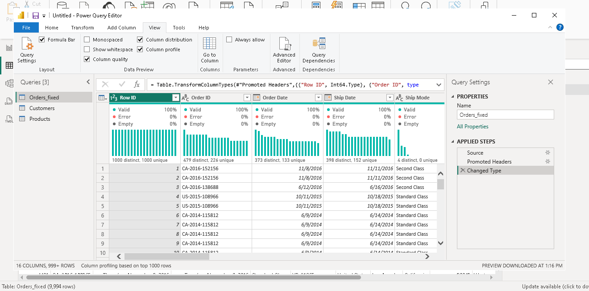
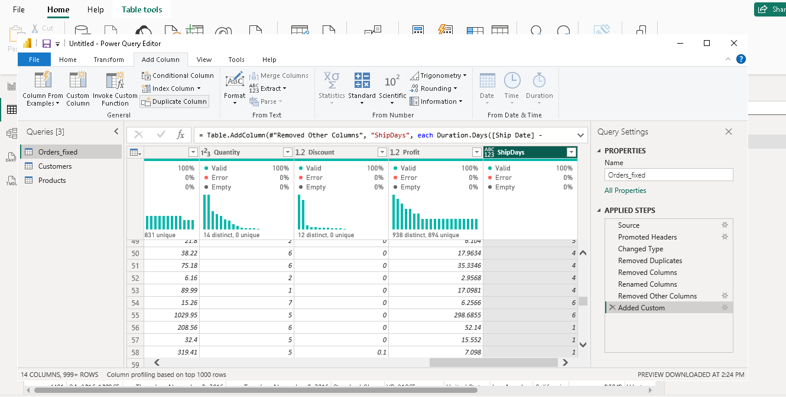
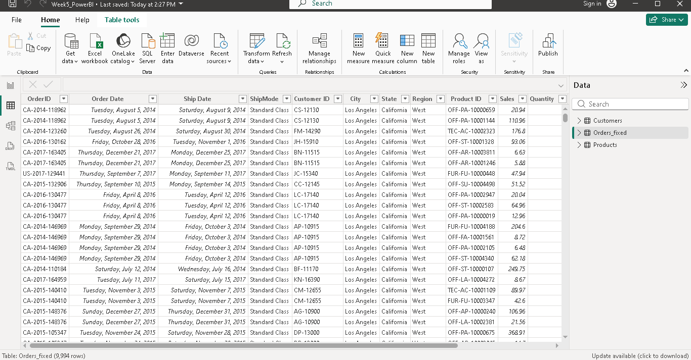

### 4.3 Data Modeling (Task 3)
Star schema with **Orders** as the fact table. All relationships are **Many-to-one** with **single direction** filtering.

| From (Many) | To (One) |
|---|---|
| Orders[Customer ID] | Customers[Customer ID] |
| Orders[Product ID] | Products[Product ID] |
| Orders[Order Date] | Calendar[Date] |

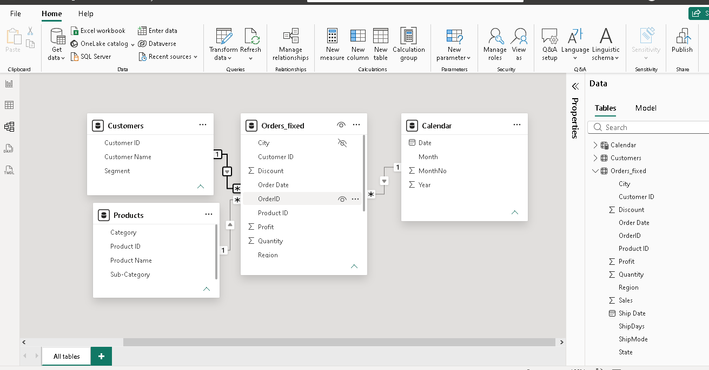

### 4.4 DAX Measures and Calculated Columns (Task 4)

```DAX
Calendar = ADDCOLUMNS(
    CALENDAR(DATE(2014,1,1), DATE(2017,12,31)),
    "Year", YEAR([Date]),
    "MonthNo", MONTH([Date]),
    "Month", FORMAT([Date], "MMM"))

Total Sales    = SUM(Orders[Sales])
Total Profit   = SUM(Orders[Profit])
Profit %       = DIVIDE([Total Profit], [Total Sales])
Average Sales  = AVERAGE(Orders[Sales])
Total Records  = COUNTROWS(Orders)
Total Orders   = DISTINCTCOUNT(Orders[OrderID])
Max Sale       = MAX(Orders[Sales])
Min Sale       = MIN(Orders[Sales])

Profit Status  = IF(Orders[Profit] < 0, "Loss", "Profit")   // calculated column
```

| Measure | Result |
|---|---|
| Total Sales | 2.30M |
| Total Profit | 286.40K |
| Profit % | 12.47% |
| Average Sales | 229.86 |
| Total Records | 9,994 |
| Total Orders | 5,009 |
| Max Sale | 22,638.48 |
| Min Sale | 0.44 |

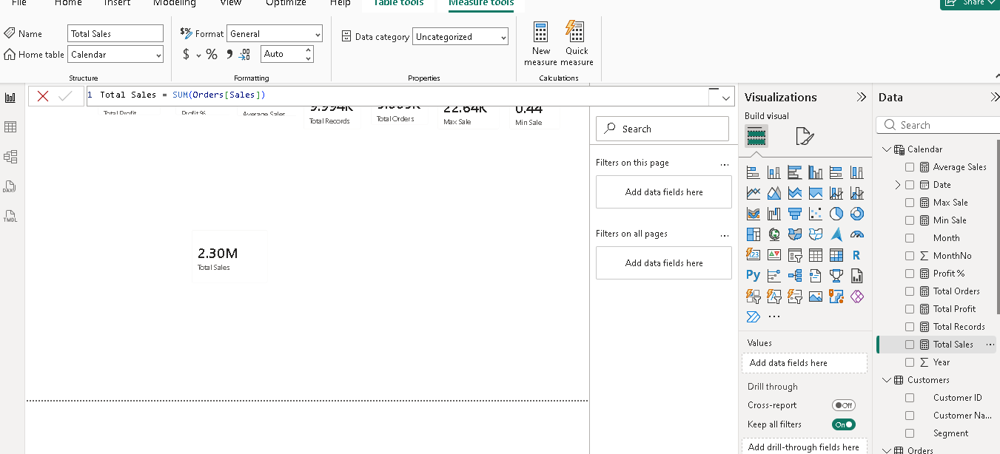

### 4.5 KPI Cards
Four cards: Total Sales, Total Profit, Profit % and Total Orders.

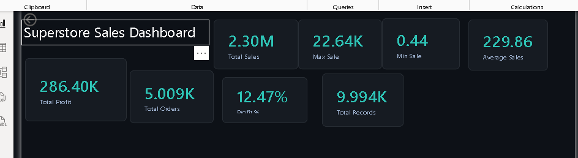

### 4.6 Column Chart: Sales by Category
Fields: Category, Total Sales. Shows which category sells the most.

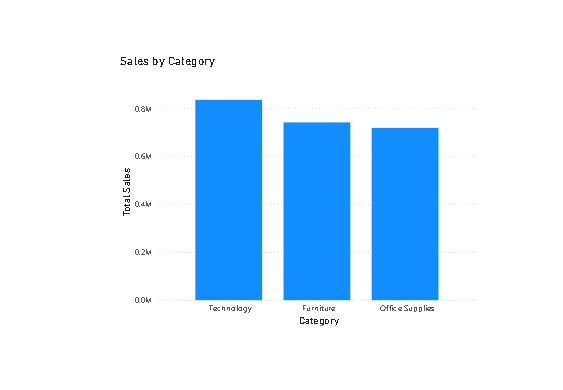

### 4.7 Line Chart: Monthly Sales Trend
Fields: Month, Total Sales. Shows how sales change across months.

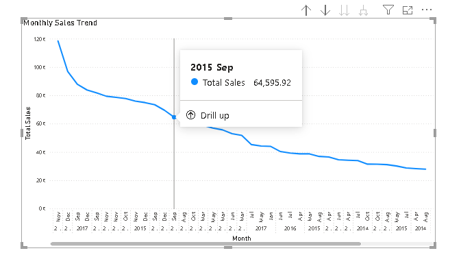

### 4.8 Donut Chart: Sales by Customer Segment
Fields: Segment, Total Sales. Shows the share of each customer segment.

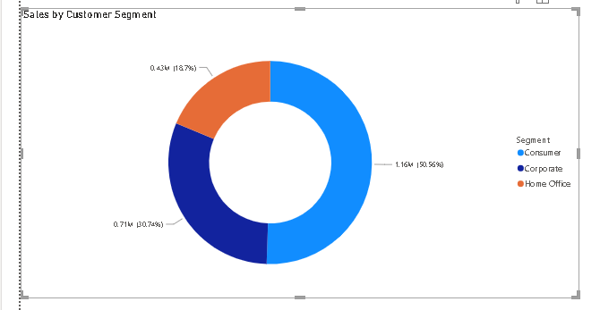

### 4.9 Bar Chart: Profit by Sub-Category
Fields: Sub-Category, Total Profit. Shows which sub-categories give the most profit.

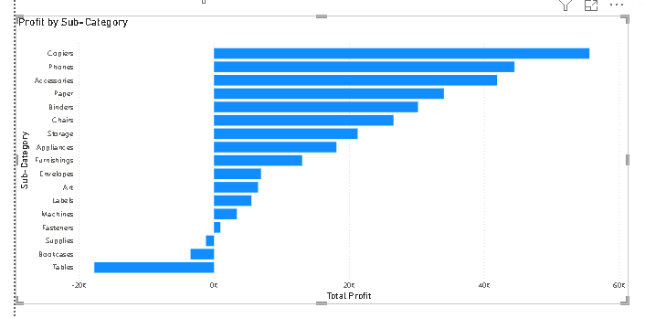

### 4.10 Table: Top Products
Fields: Product Name, Total Sales, Total Profit. Sorted by Total Sales (high to low).

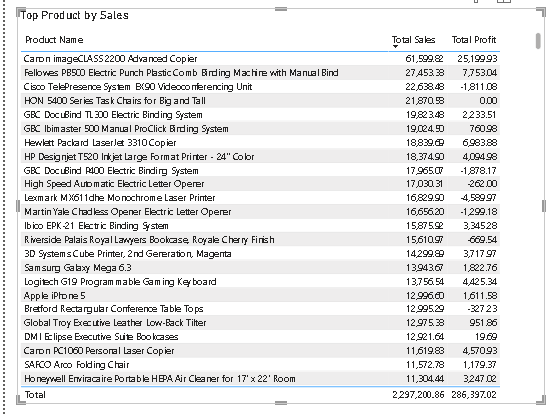

### 4.11 Slicers and Interactive Dashboard (Task 6)
Two slicers (**Year** and **Region**) control all cards and visuals. Cross-filtering also works by clicking a bar or a donut slice.


---

## 5. Insights and Recommendations (Task 7)

**Key insights**
1. **Consumer** is the largest segment with about **50.56%** of sales (1.16M). Corporate has 30.74% and Home Office 18.7%.
2. **Technology** is the top category by sales. Furniture and Office Supplies are close to each other.
3. **Copiers** give the highest profit. The **Canon imageCLASS 2200 Advanced Copier** is the top product (Sales 61,599.82, Profit 25,199.93).
4. Some high-selling products make a **loss**, for example Cisco TelePresence System EX90 (-1,811.08) and GBC DocuBind P400 (-1,878.17).
5. The overall **profit margin is 12.47%**, i.e. about 12 rupees profit on every 100 rupees of sales.
6. Sales rise in the last quarter of the year (September to December), which points to **seasonal demand**.

**Recommendations**
1. Reduce discounts or revise the price of loss-making products such as Cisco TelePresence and GBC DocuBind P400.
2. Give more focus (stock and promotion) to Technology and Copiers, because they bring the most profit.
3. Prepare stock and offers before September to December to use the seasonal demand.
4. Launch special offers for Corporate and Home Office customers to grow their share.

---

## 6. Repository Contents

| File / Folder | Description |
|---|---|
| `Week5_PowerBI_Gajanan.pdf` | Full report with all tasks and screenshots (Task 1 to 7) |
| `Week5_PowerBI_Gajanan__Raje.pbix` | Power BI project file (open with Power BI Desktop) |
| `Orders_fixed.csv`, `Customers.csv`, `Products.csv` | Dataset files |
| `1_orders.PNG` ... `19_filtered.PNG` | Step-by-step screenshots |
| `README.md` | This file |

---

## 7. How to Open the Project

1. Install **Power BI Desktop** (free, Windows).
2. Download `Week5_PowerBI_Gajanan__Raje.pbix` from this repository.
3. Open it in Power BI Desktop. If asked, update the data source path to the downloaded CSV files (Home > Transform data > Data source settings).
4. Use the **Year** and **Region** slicers to explore the dashboard.

---

## 8. Conclusion

Power BI helped to convert raw sales data into a clean model and an interactive dashboard. Sales, profit, customers and products can now be seen in one place, which supports better business decisions.
